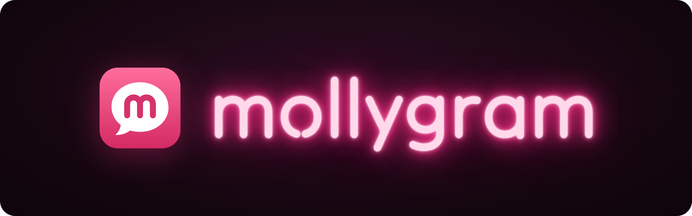

<p align="center">
  
</p>

<p align="center">
  Кастомный клиент Telegram для десктопа на Flutter: macOS, Windows, Linux.
</p>

<p align="center">
  <a href="https://github.com/mollybyte/mollygram/actions/workflows/ci.yml"></a>
  <a href="LICENSE"></a>
  <a href="https://github.com/mollybyte/mollygram/commits/main"></a>
  
</p>

<p align="center">
  <a href="https://flutter.dev"></a>
  <a href="https://dart.dev"></a>
  <a href="https://github.com/tdlib/td"></a>
  
  
  
</p>

---

Раскладка как у официального Telegram Desktop, чтобы не переучиваться. Сверху liquid glass и то, чего не хватает в официальном клиенте.

> [!NOTE]
> Ранняя стадия: есть макеты и основа проекта с привязкой к TDLib, интерфейса и входа в аккаунт пока нет.

## Что планируется

| | |
|---|---|
| **Плагины** | Песочница с явными правами в манифесте, в духе exteraGram. |
| **Приватность** | Режим призрака: без отметок о прочтении, без «печатает» и статуса «в сети». Локальное сохранение удалённых сообщений и история правок. |
| **Медиа** | Кружки в 120 кадров/с и до 1080p, фото и видео без сжатия по умолчанию. |
| **Работа с чатами** | Вкладки, сплит на два чата, командная палитра по <kbd>⌘</kbd> <kbd>K</kbd>. |
| **Внешний вид** | Liquid glass только на плавающем слое: боковая панель, шапка чата, поле ввода, палитра. Светлая и тёмная темы. |

## Стек

| Компонент | Что используем |
|---|---|
| UI | [Flutter](https://flutter.dev) desktop, канал stable |
| Протокол | [TDLib](https://github.com/tdlib/td) через `dart:ffi` |
| Платформы | macOS, Windows, Linux |

Первое, что нужно проверить: держит ли Flutter размытие под прокручиваемым чатом и воспроизведение кружков в 120 кадров/с.

## CI/CD

| Workflow | Когда запускается | Что делает |
|---|---|---|
| [`ci.yml`](.github/workflows/ci.yml) | push в `main`, pull request | `dart format`, `flutter analyze`, `flutter test`, затем release-сборка под macOS, Windows и Linux |
| [`release.yml`](.github/workflows/release.yml) | тег `v*` | Собирает три платформы с ключами из секретов и публикует архивы в GitHub Releases |
| [`tdlib.yml`](.github/workflows/tdlib.yml) | смена версии TDLib, вручную | Собирает universal `libtdjson.dylib` для macOS и публикует в релиз `tdlib-<версия>` |

## Разработка

| Пакет | Что внутри |
|---|---|
| [`packages/tdlib`](packages/tdlib) | Привязка `dart:ffi` к td_json, цикл `td_receive` в фоновом изоляте, типы td_api из схемы |
| `packages/core` | Модели и состояние поверх TDLib, без Flutter |
| `packages/ui_kit` | Общие виджеты, стекло, тема |
| `packages/media` | Видео, кружки, голосовые |
| `packages/plugin_host` | Песочница плагинов |
| `packages/app` | Само приложение |

Монорепо на [pub workspaces](https://dart.dev/tools/pub/workspaces): `flutter pub get` в корне ставит зависимости всех пакетов.

Ключи Telegram в репозиторий не попадают. Получите `api_id` и `api_hash` на [my.telegram.org](https://my.telegram.org), скопируйте [`config/telegram.example.json`](config/telegram.example.json) в `config/telegram.json` (он в `.gitignore`) и запускайте так:

```sh
cd packages/app
flutter run -d macos --dart-define-from-file=../../config/telegram.json
```

Для релизов те же значения лежат в секретах репозитория `TELEGRAM_API_ID` и `TELEGRAM_API_HASH`.

## Бренд


Значок: белый пузырь сообщения с буквой m на малиновом фоне. Неоновый вордмарк используется только в промо: README, лендинг, канал. В самом приложении неона нет.

| Цвет | Светлая тема | Тёмная тема |
|---|---|---|
| Акцент по умолчанию |  |  |
| Малиновый акцент (опция) |  |  |
| Исходящие, малиновая тема |  |  |
| Неон, только промо |  |  |

Акцент в приложении по умолчанию системный синий, малиновый включается в настройках. Исходники значка лежат в [`docs/assets`](docs/assets).

## Макеты

В `design/` лежат исходники интерактивных макетов: главное окно, медиа и файлы чата, плагины, командная палитра и настройки. Это формат дизайн-канваса (`.dc.html`), сам по себе в браузере он не откроется.

## Лицензия

[GPL-3.0](LICENSE)
