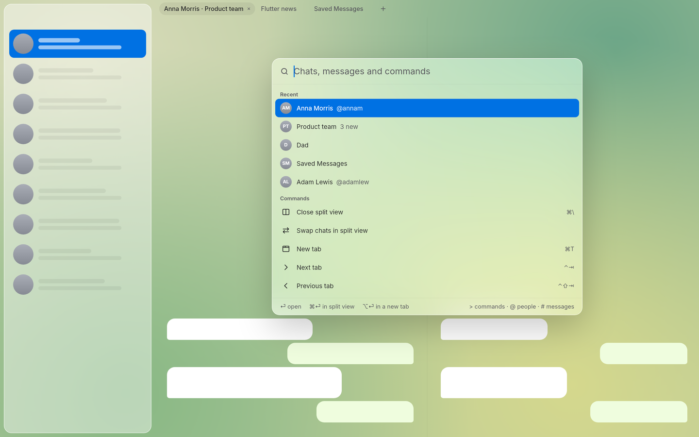

# mollygram_shell

The window layout of Mollygram: chat tabs, split view and the ⌘K command palette.



## Workspace instead of routes

The window has no route stack. Its state is a `Workspace`: a list of tabs, each with one or two panes, and each pane shows one chat (or waits for one). Every change is a pure function on an immutable value, held by a `WorkspaceController`:

```dart
final workspace = WorkspaceController();
workspace.open(chatId);                              // ⏎  focused pane
workspace.open(chatId, target: OpenTarget.split);    // ⌘⏎ next to the current chat
workspace.open(chatId, target: OpenTarget.newTab);   // ⌥⏎ a new tab
```

Rules that keep it predictable:

- A chat that is already open is revealed instead of being opened twice. Split view only avoids duplicates inside the active tab.
- ⌘W closes the focused half of a split view first, then the tab. Closing the last tab leaves one empty tab.
- Closing the active tab activates its right neighbour, as in browsers. ⌘9 is always the last tab.
- `toJson` / `Workspace.fromJson` save and restore the layout; malformed data falls back to one empty tab.

## The shell widget

`WorkspaceShell` draws the sidebar slot, the tab strip (only with two or more tabs), the panes with a draggable divider (double click resets it), and the palette. It reads chats only through the `ChatDirectory` interface; `MockChatDirectory` serves tests and development until the TDLib-backed directory lands.

```dart
WorkspaceShell(
  controller: workspace,
  directory: directory,
  sidebar: const ChatList(),
  sidebarWidth: 320,
  commands: [/* app and plugin commands */],
  paneBuilder: (context, chat, focused) =>
      chat == null ? EmptyPane(strings: strings) : ChatView(chat),
);
```

## Shortcuts

| Keys | Action |
|---|---|
| ⌘K | Command palette |
| ⌘T | New tab |
| ⌘W | Close the split pane or the tab |
| ⌘\ | Split view on or off |
| ⌘1 … ⌘9 | Go to a tab, ⌘9 is the last one |
| ⌃⇥ / ⌃⇧⇥ | Next and previous tab |
| ⌘⌥← / ⌘⌥→ | Focus the left or right pane |

On Windows and Linux ⌘ is Ctrl and ⌥ is Alt.

## Palette

The palette opens and closes instantly and does not dim the window. Prefixes are the same in every language: `>` commands, `@` people, `#` messages. Built-in commands also match their title in the other UI language. Other packages add commands through `WorkspaceShell.commands`.

Strings live in `ShellStrings` in English and Russian; both implement one interface, so a missing translation does not compile.

## Screenshots

`MG_SHOT_DIR=/tmp/shots flutter test test/screenshot_test.dart` renders the window in light and dark themes, with and without the palette.
